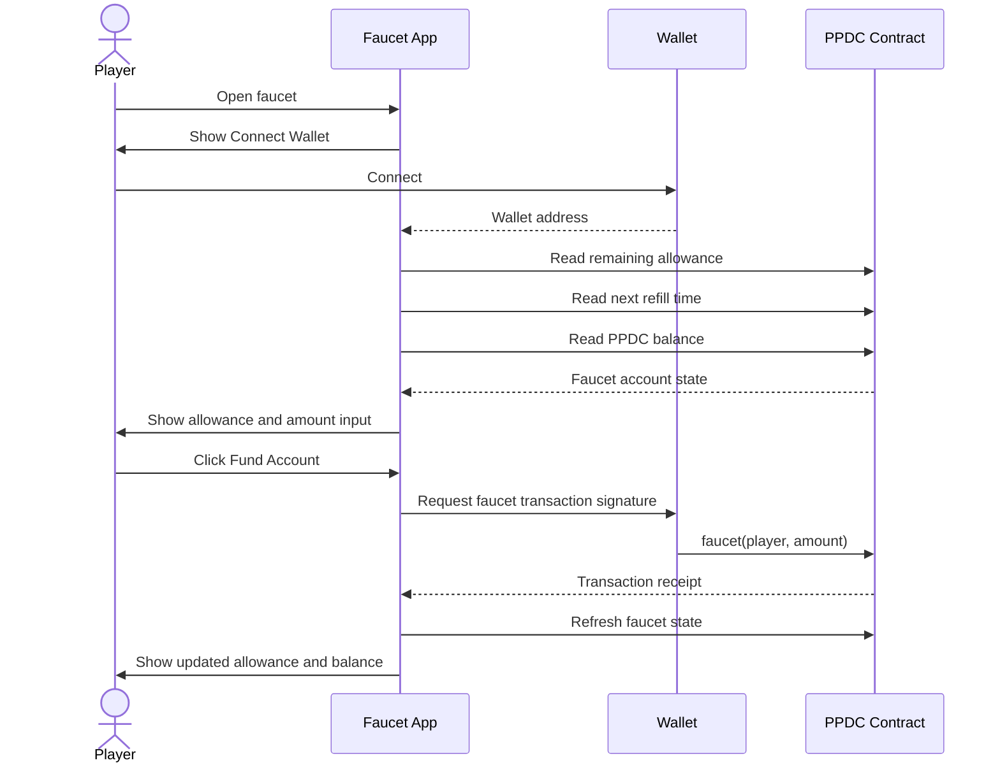
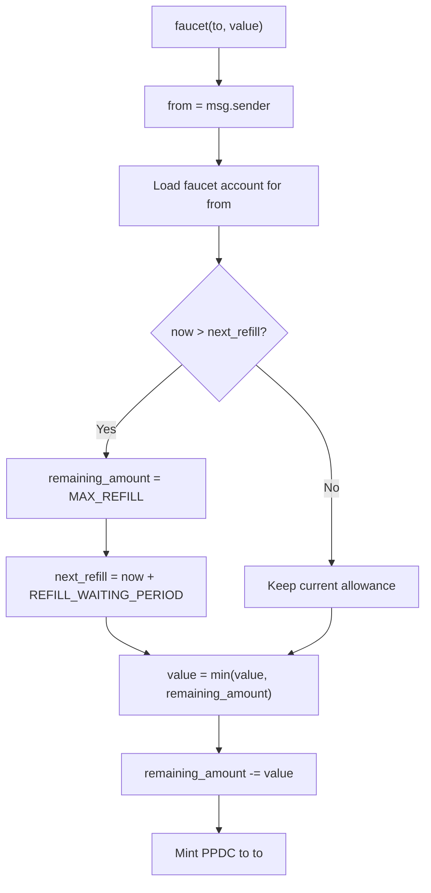

# Funding Flow

## Goal

The faucet flow gives a test player enough PPDC to exercise Private Poker flows
without introducing open-ended token distribution. The key rule is that the app
uses the connected wallet as both the faucet account and the beneficiary.

This makes the user experience simple and keeps the faucet's surface area narrow:
the player can fund themselves, but cannot use this interface to fund someone
else.

## User Flow



## Allowance And Refill

The PPDC contract stores faucet state per wallet:

- `remaining_amount` is how much PPDC the wallet can still request during the
  current refill period.
- `next_refill` is the next timestamp at which the allowance can refresh.

The contract refills the account before applying the request cap. This matters
for first-time users because a new faucet account has no stored allowance yet.
When `now > next_refill`, the contract resets the allowance to the monthly
maximum first, then caps the requested funding amount.



## First-Call Behavior

The UI mirrors the contract's refill-before-cap rule. If the chain reports a
past or zero `next_refill`, the screen presents the effective allowance as the
full refill amount. This avoids a confusing first-use state where the raw stored
allowance is zero even though the contract will allow funding.

The contract remains the source of truth. The UI calculation exists only to show
the user the same effective allowance the contract will apply.

## Amount Handling

The amount field accepts PPDC values in human units. PPDC uses 6 decimals, so the
app converts the input with Viem before submitting the transaction.

The app caps the submitted value to the effective remaining allowance. The
contract also applies the same cap, so the UI and contract agree even if the
displayed state becomes stale between read and transaction submission.

## Self-Funding Rule

The current app always calls:

```text
faucet(connected_wallet, capped_amount)
```

The faucet contract supports separate `from` and `to` concepts by using
`msg.sender` as the account whose allowance is consumed and `to` as the
beneficiary. This app intentionally passes the connected wallet as `to`, so
normal users only fund themselves.
