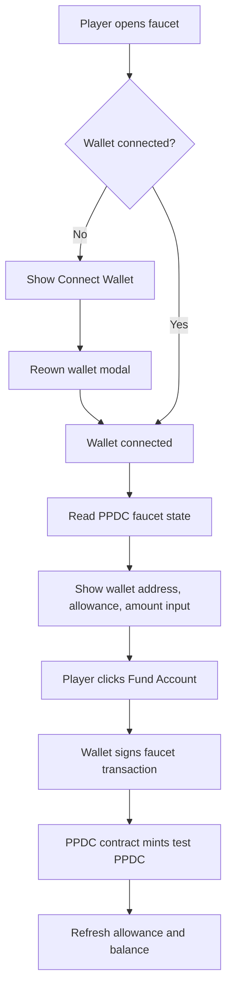

# Private Poker Faucet Overview

## Purpose

Private Poker Faucet is a deliberately small wallet app for funding test players
with PPDC. PPDC is the test USDC token used by the Private Poker development
environment before chips enter the wider poker settlement flow.

The app exists so a player can fund their own wallet without needing a project
operator to manually transfer test tokens. This keeps local and Sepolia testing
fast while keeping the faucet policy simple: one connected wallet funds the same
wallet, capped by the contract allowance.

## Scope

The app has one screen and one business operation:

- Connect a wallet through Reown.
- Read the connected wallet address.
- Read the wallet's PPDC faucet state from the PPDC contract.
- Let the wallet request PPDC for itself.
- Wait for the transaction to confirm.
- Refresh the allowance and PPDC balance after funding.

The app does not let a user fund a different address. That is intentional. It
keeps the user-facing faucet aligned with the simple test-user case: "fund my
own account so I can continue testing Private Poker."

## Architecture

## Main Components

- `app/page.jsx` renders the faucet client.
- `components/Providers.jsx` configures Reown, Wagmi, Viem transports, and React
  Query.
- `components/FaucetClient.jsx` owns the screen state and contract calls.
- `lib/chain/index.js` selects the active chain configuration.
- `next.config.mjs` enables the local devnode RPC rewrite only when devnode mode
  is selected.

## Chain Selection

The active chain is selected with `NEXT_PUBLIC_PRIVATE_POKER_CHAIN`.

- `devnode` uses the local Nitro dev node through `/local-rpc`.
- `sepolia` uses Arbitrum Sepolia directly.
- If the variable is omitted or unknown, the app falls back to Sepolia.

The Reown project ID is shared with the existing Private Poker Vite app so the
same wallet-connect configuration can be reused during development.
